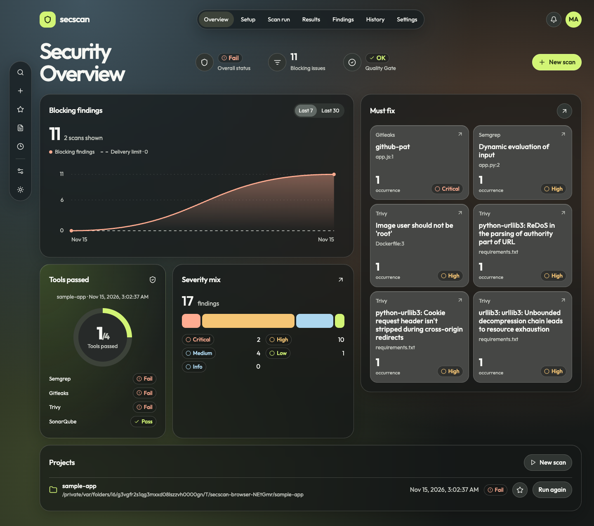

# secscan

secscan helps development teams check whether a project is ready to deliver. It runs four scanners against a project folder, applies a shared delivery policy, and writes one verdict with findings and suggested fixes. Use it from the command line or from a dashboard that runs on your machine.

[One-page project overview](output/pdf/secscan-overview.pdf) · [Dashboard guide](docs/DASHBOARD.md) · [Example reports](docs/samples/README.md)



## What it checks

| Scanner | Checks |
| --- | --- |
| [Semgrep](https://semgrep.dev/) | Insecure code patterns using named rule packs or local rules |
| [Gitleaks](https://github.com/gitleaks/gitleaks) | Exposed credentials in Git history or, for folders outside Git, in the current files |
| [Trivy](https://github.com/aquasecurity/trivy) | Vulnerable dependencies and infrastructure misconfigurations |
| [SonarQube](https://docs.sonarsource.com/sonarqube-community-build/) | Code quality and security findings, with the server's Quality Gate verdict |

Each scanner reports its own status. The scan continues when an individual tool fails. The [delivery policy](THRESHOLDS.md) determines which findings block delivery, and approved exceptions require an approver, a reason, and an expiration date.

## Quick start

1. Install Python 3.9+ and the four scanner executables using the [developer guide](docs/DEVELOPER_GUIDE.pdf). Keep the tools on your PATH. Git enables history scanning. See the [tested tool versions](secscan/data/tools.lock).
2. Clone the repository and enter its folder.

   ```sh
   git clone https://github.com/mahmoodsr/secscan.git
   cd secscan
   ```

3. Install secscan and open the dashboard.

   **macOS**

   ```sh
   python3 -m venv .venv
   .venv/bin/python -m pip install .
   ./run-security-scan.sh --ui
   ```

   **Windows PowerShell**

   ```powershell
   py -3 -m venv .venv
   .\.venv\Scripts\python.exe -m pip install .
   .\run-security-scan.ps1 -UI
   ```

4. In the dashboard, enter your SonarQube URL and user token in **Settings**, then select **Setup → Test connection**. If you need a SonarQube instance, follow the [local setup steps](#run-sonarqube-locally).
5. Select **Scan run → Browse**, choose a project folder, and start the scan. Open **Results** to see whether delivery is blocked, then use **Findings** to investigate or **History** to compare the next scan after fixes.

## Dashboard pages

| Page | What you can do |
| --- | --- |
| **Overview** | See the selected project's latest completed scan, the number and status of tools that passed, the findings trend, and issues to fix first. |
| **Setup** | Check installed tool versions, find install commands, and test the SonarQube connection. |
| **Scan run** | Choose a folder, start a scan, follow progress and log output, or cancel. |
| **Results** | Review the delivery verdict, severity totals, and SonarQube Quality Gate. Download HTML, Markdown, or JSON. |
| **Findings** | Filter by tool, severity, category, or file. Search by text and open a finding for its location and available fix guidance. |
| **History** | Compare two scans of the same project to see which findings are new, fixed, or unchanged. |
| **Settings** | Configure SonarQube, manage project exclusions and exceptions, view delivery thresholds, and switch themes. |

[See all seven screens](docs/ui-review/README.md)

## Run from the command line

After installation, scan a folder or run the bundled self-test.

| Task | macOS | Windows PowerShell |
| --- | --- | --- |
| Scan a folder | `./run-security-scan.sh /path/to/project` | `.\run-security-scan.ps1 C:\path\to\project` |
| Verify the setup | `./run-security-scan.sh --self-test` | `.\run-security-scan.ps1 -SelfTest` |

With no project argument, the wrappers scan the current directory. The installed package also provides `secscan scan`, `secscan self-test`, and `secscan ui`. The macOS wrapper checks `.scan-tools/bin` in the checkout if it exists.

| macOS option | Windows option | Use |
| --- | --- | --- |
| `--only` / `--skip` | `-Only` / `-Skip` | Select comma-separated tool IDs from `semgrep,gitleaks,trivy,sonar`. |
| `--timeout` | `-Timeout` | Set a per-tool timeout in minutes. |
| `--build` | `-Build` | Run the project's Maven, Gradle, or .NET build for deeper analysis. |
| `--no-fail` | `-NoFail` | Return exit code 0 after writing reports and preserve the verdict in the summary. |

### Read the verdict

Open `scan-reports/summary.html` in the scanned project. The same folder contains the Markdown and JSON summaries, tool reports, logs, and progress events. Dashboard runs also archive completed reports under `scan-reports/history/`.

| Exit code | Meaning |
| --- | --- |
| `0` | All four scanners passed or informational exit was requested. |
| `1` | A blocking finding or a failed SonarQube Quality Gate. |
| `2` | An incomplete scan with no blocking result. |
| `3` | The scan could not start or write reports. |

If a scan was forcibly terminated and secscan reports an active writer, check the PID in `scan-reports/.active` before removing the lock file.

## Configure secscan

- **Delivery thresholds** live in the [runtime policy](secscan/data/THRESHOLDS.yml) and are documented in [THRESHOLDS.md](THRESHOLDS.md).
- **Exclusions and exceptions** can be set in the dashboard or by copying the [example configuration](.scan-config.example.yml) to `.scan-config.yml` in the scanned project's root.
- **SonarQube credentials** can be saved to macOS Keychain or Windows Credential Manager through dashboard Settings. For terminal runs, set `SONAR_HOST_URL` and `SONAR_TOKEN` in your shell. Values from the launch shell take precedence in the dashboard.

### Run SonarQube locally

For a personal test setup, start Docker and run SonarQube Community Build on loopback with its embedded database.

```sh
docker run -d --name secscan-sonarqube \
  -p 127.0.0.1:9000:9000 \
  -e SONAR_ES_BOOTSTRAP_CHECKS_DISABLE=true \
  sonarqube:26.10.0.133078-community
```

If Docker Desktop uses its separate context, run the command with `docker --context desktop-linux`. For later sessions, start the same container with `docker start secscan-sonarqube` in that context.

Open [localhost:9000](http://127.0.0.1:9000), sign in with `admin` / `admin`, and set a new password. Generate a **User Token** in **My Account → Security**. Save it in dashboard Settings or enter it using the hidden prompt below in macOS zsh.

```zsh
export SONAR_HOST_URL=http://127.0.0.1:9000
read -rs 'SONAR_TOKEN?Paste your SonarQube token: '
echo
export SONAR_TOKEN
./run-security-scan.sh --self-test
```

For a shared server or a custom Quality Gate, see the [SonarQube administrator guide](docs/SONAR_ADMIN.md).

## How it works

The Python engine launches the scanner executables, normalizes severity, applies the delivery policy, and writes redacted reports. The React dashboard connects to a local FastAPI server. The server starts the same engine, reads scan events and summaries, and indexes scan history in SQLite.

| Path | Contents |
| --- | --- |
| [`secscan/`](secscan/) | CLI, scan engine, report generation, and dashboard API |
| [`dashboard/`](dashboard/) | React frontend, design tokens, and browser tests |
| [`tests/`](tests/) | Engine and dashboard API tests with scanner fixtures |
| [`docs/`](docs/) | Setup guides, demo, sample reports, and verification results |

The live scanner self-test and dashboard browser tests ran on macOS. Windows wrappers and dashboard support are included, with the Windows self-test still pending. See the [test report](docs/TEST_REPORT.md) for what was verified.

For development, install test dependencies with `python -m pip install '.[test]'` and run `python -m unittest discover -s tests -v`. See the [dashboard guide](docs/DASHBOARD.md) for rebuilding the frontend and running browser tests, and the [demo walkthrough](docs/DEMO.md) for a before-and-after scan.
